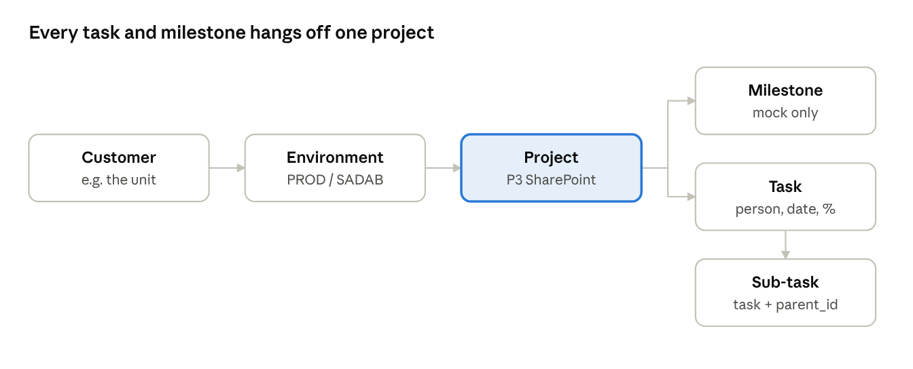

# TeamScheduler – Project object model

As of 2026-10-20 · Copy of the live doc: https://claude.ai/code/artifact/e193a79a-5f65-4d37-9913-76bd17875e43

## Hierarchy

A project belongs to one environment, which belongs to one customer; tasks and milestones belong to the project. People are one shared list, not owned by any customer.

## Core project fields (in the real app)

These fields already exist in the live app (`Scheduler.psm1` + `scheduler_v3.html`).

| Field | Shown as | Meaning |
| --- | --- | --- |
| `id` | P3 | Project ID |
| `domain_id` | סביבה | The environment it belongs to; the customer comes from the environment |
| `name` | פרויקט | e.g. SharePoint |
| `color` | colour swatch | One colour or a gradient |
| `status` | פעיל / סגור | A closed project is hidden but not deleted |
| `deadline` | יעד | Optional due date (yyyy-MM-dd) |
| `lead_days` | זמן בנייה | Days the project needs before its deadline, so the projects it depends on must finish this much earlier (default 14) |
| `depends_on` | תלוי ב | Other projects of the same customer that this one waits for |

## Excel-Gantt fields (mock only)

Added to the mock from the manager's Excel Gantt. None of these exist in the real app yet.

| Field | Excel column | Meaning |
| --- | --- | --- |
| `branch` | צוות | The team that owns it: DEVOPS / תקשורת / תשתיות |
| `category` | תחום | Type of work: שדרוג / פיתוח / תפעול |
| `cbranch` | ענף לקוח | The customer's department: ענן / סייבר / מערכות מידע / הנדסת רשת |
| `engineer` | מהנדס | One person |
| `lead` | ראש צוות | One person |
| `integ[]` | אינטגרציה | One or more people |
| `focus` | מיקוד לחודש הקרוב | Free text |
| `milestones[]` | the boxes on the timeline | List of milestones (see below) |

## Computed values (not stored)

The app works these out on every render; nobody types them in.

| Value | Shown as | How it is worked out |
| --- | --- | --- |
| Effective deadline | יעד / יעד נגזר (italic) | The project's own deadline, or an earlier one taken from a project that depends on it, minus that project's `lead_days` |
| Start → end | Gantt bar | From the first task date to the last |
| Progress % | % on the bar / card | Average of the project's tasks |
| Status | פעיל · בלו"ז / עבר היעד / משימות אחרי היעד / סגור | From `status`, the effective deadline and the task dates |
| Customer | לקוח | Taken from the environment |

## What sits inside a project

A project holds tasks (which can have sub-tasks) and milestones.

**Task**

| Field | Meaning | In real app? |
| --- | --- | --- |
| `id` | Task ID (T412) | Yes |
| `project_id` | The project it belongs to | Yes |
| `person_id` | Assigned person; 0 = לא משובץ | Yes |
| `title` | Task name | Yes |
| `date` | Start date | Yes |
| `start_min` / `duration_min` | Time of day + length (timed task) | Yes |
| `all_day` / `end_date` | A run of whole working days instead of a time | Yes |
| `description` | Free text | Yes |
| `percent_done` | 0–100 | Yes |
| `parent_id` | Set = this is a sub-task of that task | Mock only |

**Sub-task** = a task with `parent_id`. The parent's % is the average of its sub-tasks; deleting the parent deletes them.

**Milestone** (mock only)

| Field | Meaning |
| --- | --- |
| `title` | e.g. שליחה ללקוח, התקנה באתר |
| `date` | The day it falls on |
| `state` | ok (green) / risk (yellow) / late (red) border |

## Open points

- [ ] Rename `branch` → `team` and `cbranch` → `customer_branch` before porting; the code names don't match the screen labels.
- [ ] Can the same person be מהנדס, ראש צוות and אינטגרציה on one project? Today nothing stops it.
- [ ] Should milestone state be set by hand (as in the mock) or worked out from the date and the tasks?
- [ ] Milestones have no ID of their own yet (M1, M2…).
- [ ] Where are צוות, ענף לקוח and the people roles edited? The mock has no project editor for them.
